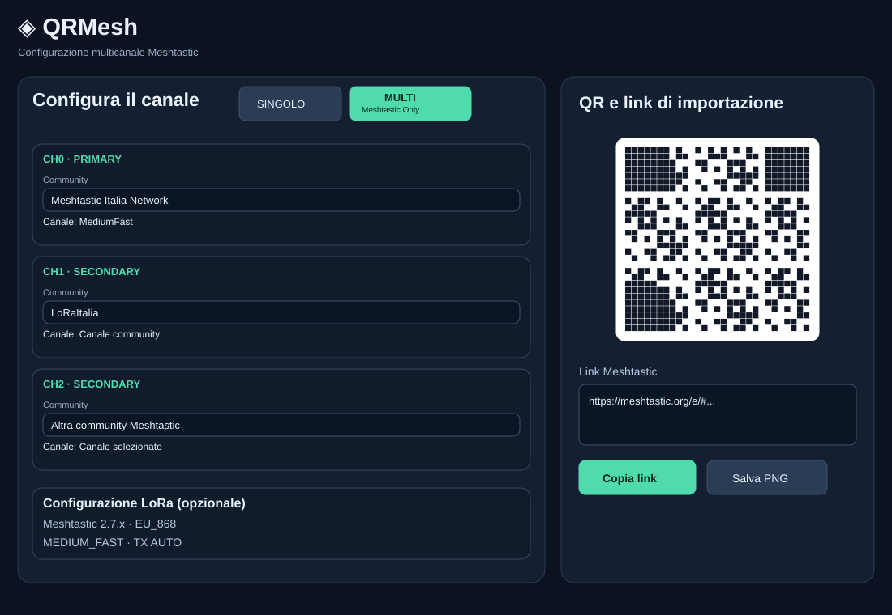
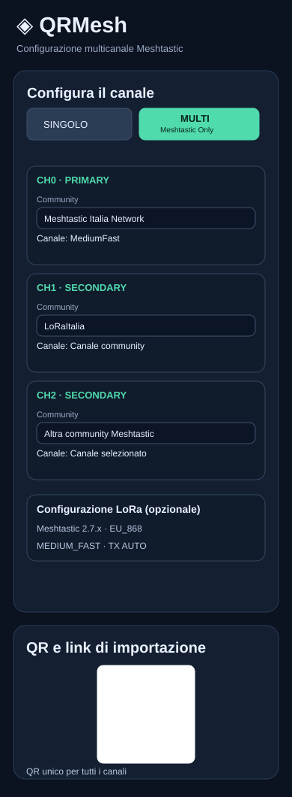

# QRMesh

Generatore open source di **QR e link di importazione per canali Meshtastic e MeshCore**, con una sezione dedicata alle risorse pubbliche delle community: siti, pagine informative e Telegram quando disponibili.

**Applicazione ufficiale:** https://allqrmesh.vercel.app/  

## Anteprime dell'interfaccia

Anteprime **illustrative** (SVG, non screenshot del browser) delle modalità SINGOLO e MULTI, su desktop e smartphone.

### SINGOLO · Meshtastic e MeshCore

 

### MULTI · Solo Meshtastic

 

[Apri il configuratore SINGOLO](https://allqrmesh.vercel.app/) · [Apri il configuratore MULTI](https://allqrmesh.vercel.app/multicanale.html)

## Funzionalità

- **SINGOLO**: selezione protocollo Meshtastic o MeshCore, community e canale pubblico, con modifica manuale di nome e PSK/secret.
- **MULTI (solo Meshtastic)**: da 1 a 8 canali (CH0 primario, CH1–CH7 secondari), ciascuno selezionabile da una community Meshtastic diversa oppure configurabile manualmente con nome e PSK. QR e link ChannelSet unici, aggiornati automaticamente.
- **LoRa opzionale in MULTI**: selezione famiglia firmware (Meshtastic 2.7/2.8 o DarkMesh 2.7.15/2.7.26), regione, modem preset e TX Power; i parametri LoRa sono comuni all'intero QR, non specifici del singolo canale.
- I pulsanti **SINGOLO / MULTI** compaiono soltanto quando è selezionato Meshtastic; MeshCore supporta il singolo canale.
- Generazione nel browser di link e QR di importazione; copia link, salvataggio PNG e stampa.
- Risorse della community selezionata con QR indipendenti per sito, documentazione e social.
- Layout desktop a griglia e **smartphone a colonna singola**, senza schede affiancate.
- Nessun account o invio delle chiavi a un server applicativo; la libreria QR viene caricata da CDN.

## Note

Le chiavi dei canali pubblici non garantiscono riservatezza. Verificare sempre canali, PSK, frequenza e regione radio con le fonti delle community. QRMesh è indipendente e non affiliato alle community citate. I link esterni possono cambiare.

## Sviluppo

Il frontend è statico: aprire `index.html` (SINGOLO) oppure `multicanale.html` (MULTI) in un browser, o pubblicarli su un host statico. La generazione dei QR richiede il caricamento della libreria esterna QRCode.js.


## Bot Telegram (backend)

L'endpoint serverless è `https://allqrmesh.vercel.app/api/telegram`. Il bot è **inattivo finché non viene configurato** e non richiede privilegi di amministratore nei gruppi.

1. Crea il bot con [@BotFather](https://t.me/BotFather) (`/newbot`) e conserva il token **privatamente**. Non pubblicarlo in GitHub o in chat.
2. In **Vercel → QRMesh → Settings → Environment Variables**, imposta `TELEGRAM_BOT_TOKEN` e `TELEGRAM_WEBHOOK_SECRET` (una stringa casuale composta da lettere, cifre, `_` o `-`, lunga 16–256 caratteri). Seleziona Production e ridistribuisci.
3. Registra il webhook da un terminale locale con il token nell'ambiente (non incollarlo nel comando salvato in cronologia):

```sh
read -rs TELEGRAM_BOT_TOKEN; echo
read -rs TELEGRAM_WEBHOOK_SECRET; echo
curl --fail-with-body -sS -X POST "https://api.telegram.org/bot${TELEGRAM_BOT_TOKEN}/setWebhook" \
  --data-urlencode "url=https://allqrmesh.vercel.app/api/telegram" \
  --data-urlencode "secret_token=${TELEGRAM_WEBHOOK_SECRET}" \
  --data-urlencode 'allowed_updates=["message","callback_query"]'
unset TELEGRAM_BOT_TOKEN TELEGRAM_WEBHOOK_SECRET
```

4. Aggiungi il bot al gruppo, lascia attiva la Privacy Mode e usa `/start`, `/community`, `/channels`, `/qr`, `/link`, `/multi`, `/social`, `/help`. Il bot risponde ai comandi e ai pulsanti, non legge la conversazione generale.

### Configurazione nel bot

- **Meshtastic**: dopo la selezione della community, scegliere **SINGOLO** o **MULTI**. In SINGOLO viene generato il QR del canale scelto.
- **MULTI**: per ogni CH0–CH7 scegliere **una community Meshtastic** e poi **un canale di quella community**. Le community possono essere diverse per ogni CH. È possibile fermarsi prima di otto canali o rimuovere l'ultimo.
- **LoRa opzionale**: scegliere firmware, regione, preset e TX Power oppure saltare questa fase. Il bot restituisce un solo QR e link di importazione Meshtastic.
- Il comando **`/multi`** avvia direttamente la scelta della community per la configurazione MULTI. **MeshCore rimane SINGOLO**.
- Il bot permette la selezione dei **canali presenti nel catalogo**; per nome/PSK personalizzati utilizzare la pagina web MULTI. Non sono previste configurazioni LoRa differenti per canale.

### Catalogo e sicurezza

Il catalogo backend è in `data/catalog.json`; la pagina web utilizza ancora il catalogo inline di `index.html`: **gli aggiornamenti ai canali vanno sincronizzati in entrambi** finché non verrà completata la migrazione a una sorgente unica. Il backend genera i QR in memoria tramite `qrcode` e non archivia utenti o messaggi.

**Test:** `node --test tests/multi.test.js` (eseguiti anche da GitHub Actions nella workflow Telegram wizard tests).

**Nota:** il webhook non è registrato automaticamente dal deployment. Per verificare la configurazione senza esporre credenziali, apri `/api/telegram` (GET).
