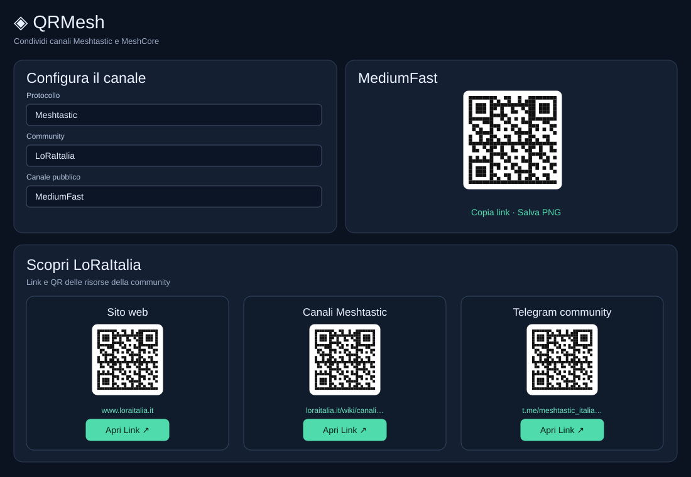
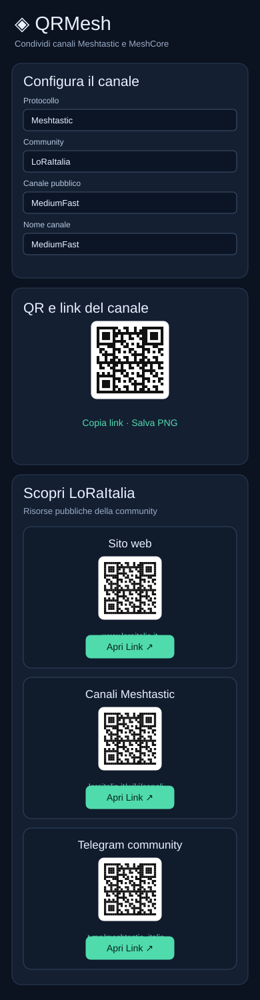

# QRMesh

Generatore open source di **QR e link di importazione per canali Meshtastic e MeshCore**, con una sezione dedicata alle risorse pubbliche delle community: siti, pagine informative e Telegram quando disponibili.

**Applicazione ufficiale:** https://allqrmesh.vercel.app/  

## Anteprime dell'interfaccia

Anteprime grafiche aggiornate dell'interfaccia (illustrazioni, non screenshot del browser): card con contenuti centrati e pulsante **Apri Link ↗**; layout desktop e smartphone a colonna singola.

 

## Funzionalità

- Selezione protocollo, community e canale pubblico, con modifica manuale di nome e PSK/secret.
- Generazione nel browser di link e QR di importazione; copia link, salvataggio PNG e stampa.
- Risorse della community selezionata con QR indipendenti per sito, documentazione e social.
- Layout desktop a griglia e **smartphone a colonna singola**, senza schede affiancate.
- Nessun account o invio delle chiavi a un server applicativo; la libreria QR viene caricata da CDN.

## Note

Le chiavi dei canali pubblici non garantiscono riservatezza. Verificare sempre canali, PSK, frequenza e regione radio con le fonti delle community. QRMesh è indipendente e non affiliato alle community citate. I link esterni possono cambiare.

## Sviluppo

Il progetto è una pagina statica: aprire `index.html` in un browser oppure pubblicarlo su un host statico. La generazione dei QR richiede il caricamento della libreria esterna QRCode.js.

Licenza: nessuna licenza esplicita è stata ancora dichiarata nel repository; aggiungerne una per definire formalmente i permessi open source.
